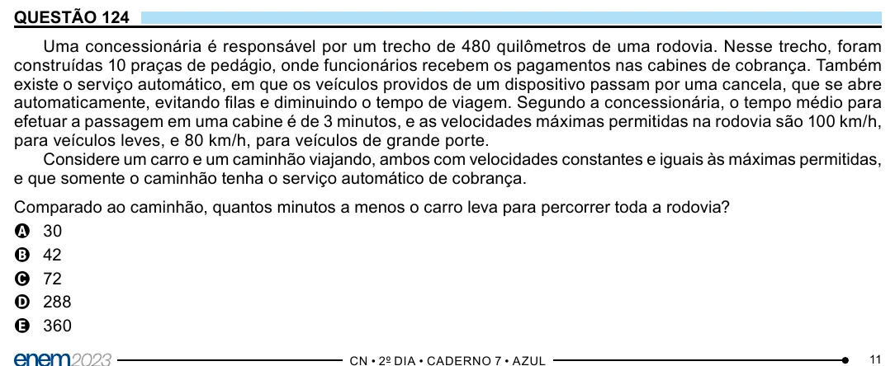

Texto extraído (pode conter ruído)

QUESTÃO 124  
Uma concessionária é responsável por um trecho de 480 quilômetros de uma rodovia. Nesse trecho, foram  
construídas 10 praças de pedágio, onde funcionários recebem os pagamentos nas cabines de cobrança. Também  
existe o serviço automático, em que os veículos providos de um dispositivo passam por uma cancela, que se abre  
automaticamente, evitando filas e diminuindo o tempo de viagem. Segundo a concessionária, o tempo médio para  
efetuar a passagem em uma cabine é de 3 minutos, e as velocidades máximas permitidas na rodovia são 100 km/h,  
para veículos leves, e 80 km/h, para veículos de grande porte.  
Considere um carro e um caminhão viajando, ambos com velocidades constantes e iguais às máximas permitidas,  
e que somente o caminhão tenha o serviço automático de cobrança.  
Comparado ao caminhão, quantos minutos a menos o carro leva para percorrer toda a rodovia?  
A 30  
B 42  
C 72  
D 288  
E 360  
11

