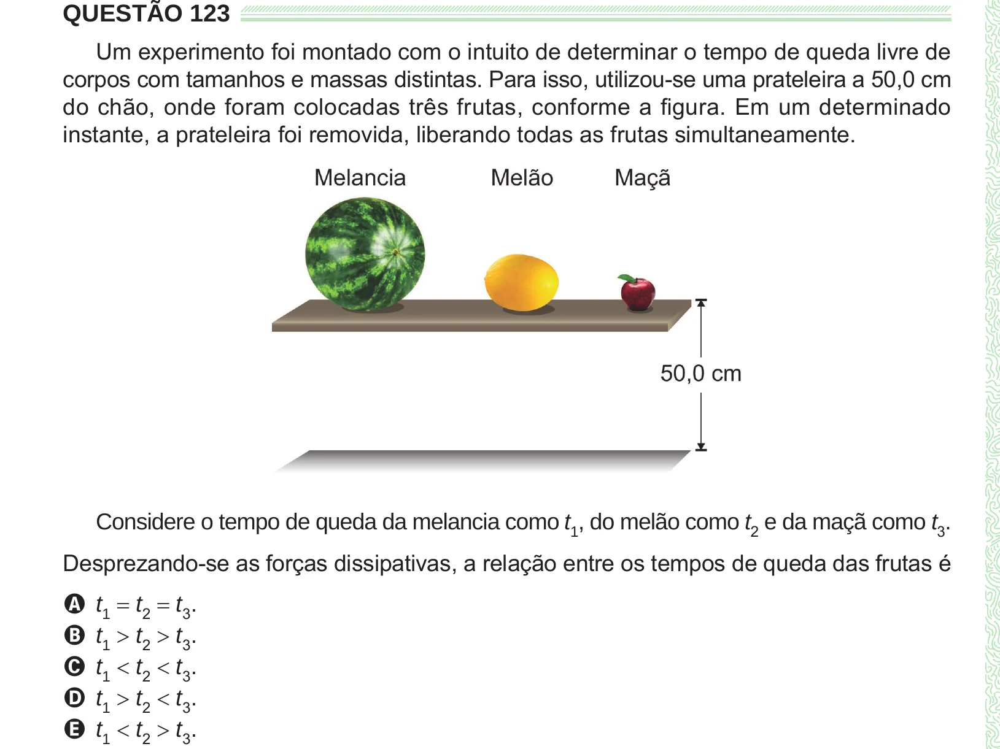

Texto extraído (pode conter ruído)

QUESTÃO 123  
Um experimento foi montado com o intuito de determinar o tempo de queda livre de  
corpos com tamanhos e massas distintas. Para isso, utilizou-se uma prateleira a 50,0 cm  
do chão, onde foram colocadas três frutas, conforme a figura. Em um determinado  
instante, a prateleira foi removida, liberando todas as frutas simultaneamente.  
Considere o tempo de queda da melancia como t 1 , do melão como t 2 e da maçã como t 3 .  
Desprezando-se as forças dissipativas, a relação entre os tempos de queda das frutas é  
A t 1 = t 2 = t 3 .  
B t 1 > t 2 > t 3 .  
C t 1 < t 2 < t 3 .  
D t 1 > t 2 < t 3 .  
E t 1 < t 2 > t 3 .

