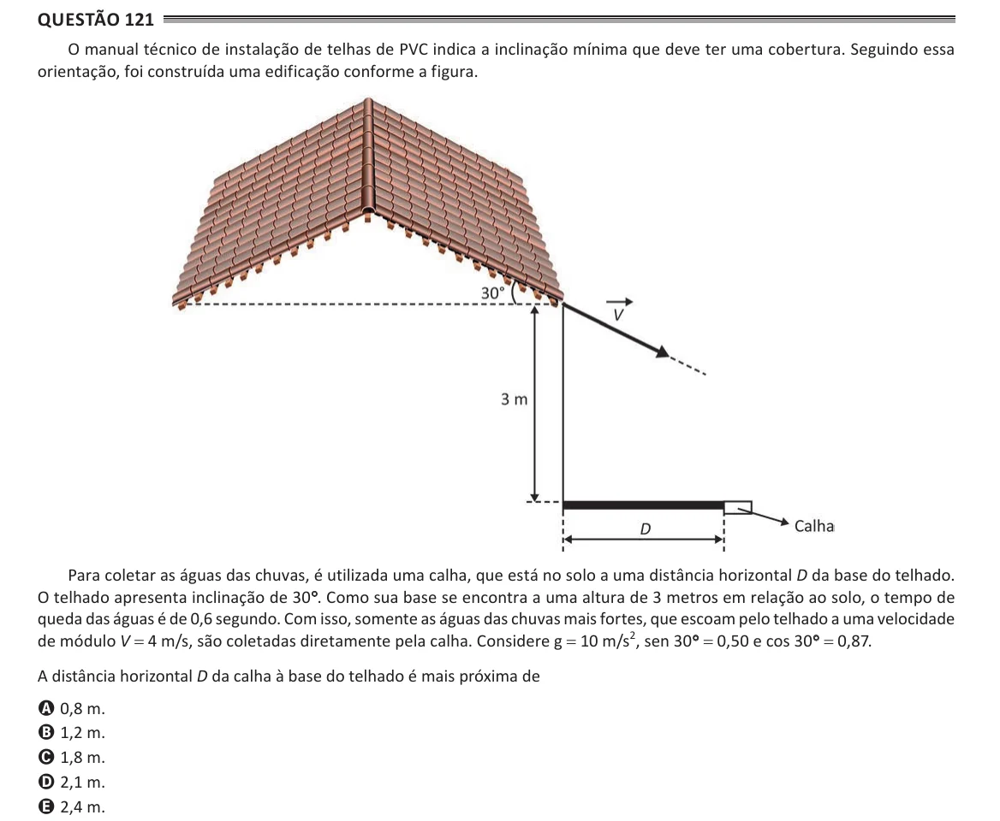

Texto extraído (pode conter ruído)

Questão 121  
O manual técnico de instalação de telhas de PVC indica a inclinação mínima que deve ter uma cobertura. Seguindo essa  
orientação, foi construída uma edificação conforme a figura.  
Para coletar as águas das chuvas, é utilizada uma calha, que está no solo a uma distância horizontal D da base do telhado.  
O telhado apresenta inclinação de 30°° . Como sua base se encontra a uma altura de 3 metros em relação ao solo, o tempo de  
queda das águas é de 0,6 segundo. Com isso, somente as águas das chuvas mais fortes, que escoam pelo telhado a uma velocidade  
de módulo V = 4 m/s, são coletadas diretamente pela calha. Considere g = 10 m/s 2 , sen 30°° = 0,50 e cos 30°° = 0,87.  
A distância horizontal D da calha à base do telhado é mais próxima de  
A 0,8 m.  
B 1,2 m.  
C 1,8 m.  
D 2,1 m.  
E 2,4 m.

