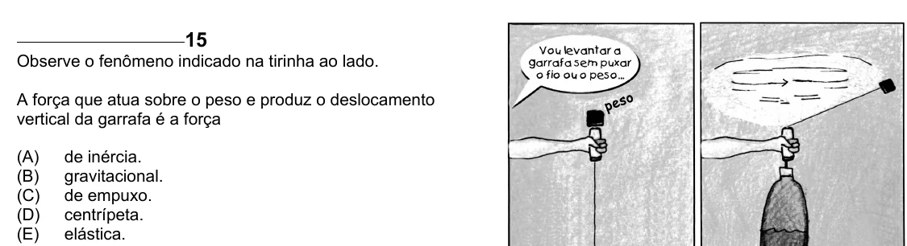

Texto extraído (pode conter ruído)

15  
Observe o fenômeno indicado na tirinha ao lado.  
A força que atua sobre o peso e produz o deslocamento  
vertical da garrafa é a força  
(A)  
de inércia.  
(B)  
gravitacional.  
(C)  
de empuxo.  
(D)  
centrípeta.  
(E)  
elástica.

