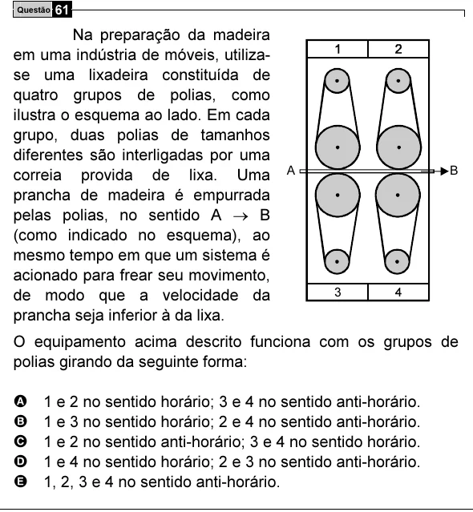

Texto extraído (pode conter ruído)

Questão 61  
Na preparação da madeira  
em uma indústria de móveis, utiliza-  
se uma lixadeira constituída de  
quatro grupos de polias, como  
ilustra o esquema ao lado. Em cada  
grupo, duas polias de tamanhos  
diferentes são interligadas por uma  
A  
B  
correia provida de lixa. Uma  
prancha de madeira é empurrada  
pelas polias, no sentido A → B  
(como indicado no esquema), ao  
mesmo tempo em que um sistema é  
acionado para frear seu movimento,  
3  
4  
de modo que a velocidade da  
prancha seja inferior à da lixa.  
O equipamento acima descrito funciona com os grupos de  
polias girando da seguinte forma:  
A  
1 e 2 no sentido horário; 3 e 4 no sentido anti-horário.  
B  
1 e 3 no sentido horário; 2 e 4 no sentido anti-horário.  
C  
1 e 2 no sentido anti-horário; 3 e 4 no sentido horário.  
D  
1 e 4 no sentido horário; 2 e 3 no sentido anti-horário.  
E  
1, 2, 3 e 4 no sentido anti-horário.

