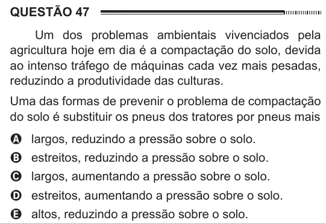

Texto extraído (pode conter ruído)

QUESTÃO 47  
Um dos problemas ambientais vivenciados pela  
agricultura hoje em dia é a compactação do solo, devida  
ao intenso tráfego de máquinas cada vez mais pesadas,  
reduzindo a produtividade das culturas.  
Uma das formas de prevenir o problema de compactação  
do solo é substituir os pneus dos tratores por pneus mais  
A largos, reduzindo a pressão sobre o solo.  
B estreitos, reduzindo a pressão sobre o solo.  
C largos, aumentando a pressão sobre o solo.  
D estreitos, aumentando a pressão sobre o solo.  
E altos, reduzindo a pressão sobre o solo.

