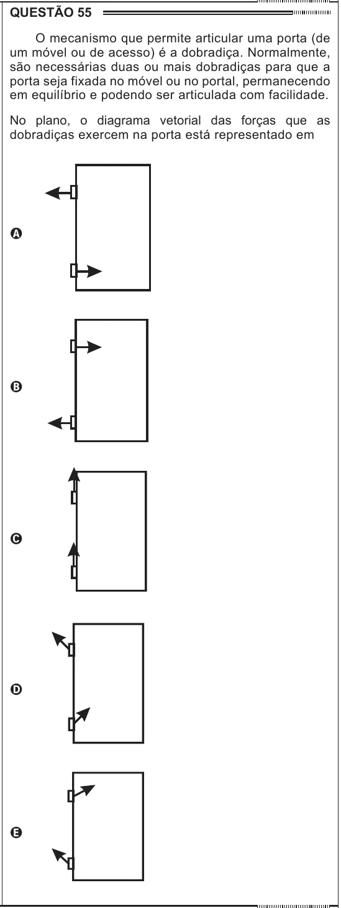

Texto extraído (pode conter ruído)

QUESTÃO 55  
O mecanismo que permite articular uma porta (de  
um móvel ou de acesso) é a dobradiça. Normalmente,  
são necessárias duas ou mais dobradiças para que a  
porta seja fixada no móvel ou no portal, permanecendo  
em equilíbrio e podendo ser articulada com facilidade.  
No plano, o diagrama vetorial das forças que as  
dobradiças exercem na porta está representado em  
A  
B  
C  
D  
E

