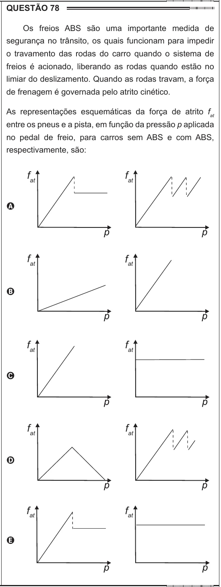

Texto extraído (pode conter ruído)

QUESTÃO 78  
Os freios ABS são uma importante medida de  
segurança no trânsito, os quais funcionam para impedir  
o travamento das rodas do carro quando o sistema de  
freios é acionado, liberando as rodas quando estão no  
limiar do deslizamento. Quando as rodas travam, a força  
de frenagem é governada pelo atrito cinético.  
As representações esquemáticas da força de atrito f at  
entre os pneus e a pista, em função da pressão p aplicada  
no pedal de freio, para carros sem ABS e com ABS,  
respectivamente, são:  
f at  
f at  
A  
f at  
f at  
B  
f at  
f at  
C  
f at  
f at  
D  
f at  
f at  
E

