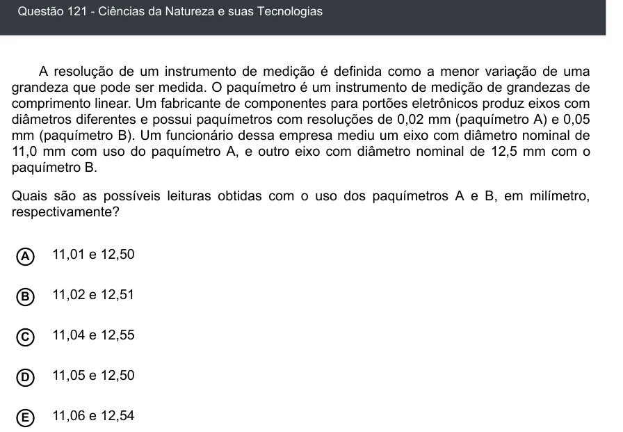

Texto extraído (pode conter ruído)

Questão 121 - Ciências da Natureza e suas Tecnologias  
A resolução de um instrumento de medição é definida como a menor variação de uma  
grandeza que pode ser medida. O paquímetro é um instrumento de medição de grandezas de  
comprimento linear. Um fabricante de componentes para portões eletrônicos produz eixos com  
diâmetros diferentes e possui paquímetros com resoluções de 0,02 mm (paquímetro A) e 0,05  
mm (paquímetro B). Um funcionário dessa empresa mediu um eixo com diâmetro nominal de  
11,0 mm com uso do paquímetro A, e outro eixo com diâmetro nominal de 12,5 mm com o  
paquímetro B.  
Quais são as possíveis leituras obtidas com o uso dos paquímetros A e B, em milímetro,  
respectivamente?  
11,01 e 12,50  
A  
11,02 e 12,51  
B  
11,04 e 12,55  
C  
D  
11,05 e 12,50  
11,06 e 12,54  
E

