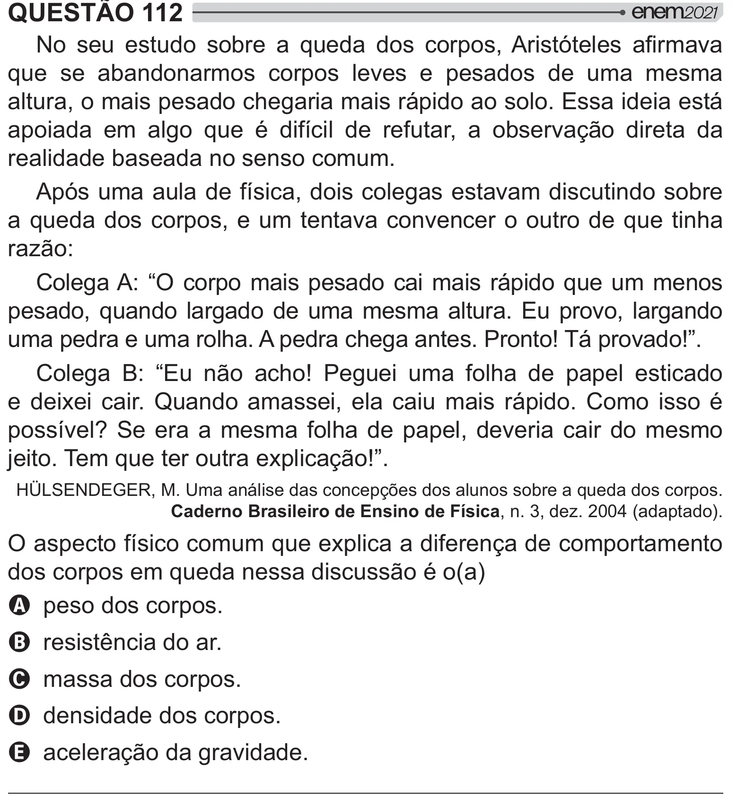

Texto extraído (pode conter ruído)

QUESTÃO 112  
ˆ  
  
 y    
   #   ƒ   "  
que se abandonarmos corpos leves e pesados de uma mesma  
altura, o mais pesado chegaria mais rápido ao solo. Essa ideia está  
apoiada em algo que é difícil de refutar, a observação direta da  
realidade baseada no senso comum.  
Após uma aula de física, dois colegas estavam discutindo sobre  
a queda dos corpos, e um tentava convencer o outro de que tinha  
razão:  
Colega A: “O corpo mais pesado cai mais rápido que um menos  
pesado, quando largado de uma mesma altura. Eu provo, largando  
uma pedra e uma rolha. A pedra chega antes. Pronto! Tá provado!”.  
Colega B: “Eu não acho! Peguei uma folha de papel esticado  
e deixei cair. Quando amassei, ela caiu mais rápido. Como isso é  
# {" ]       >$   ##   "       
jeito. Tem que ter outra explicação!”.  
HÜLSENDEGER, M. Uma análise das concepções dos alunos sobre a queda dos corpos.  
Caderno Brasileiro de Ensino de Física, n. 3, dez. 2004 (adaptado).  
O aspecto físico comum que explica a diferença de comportamento  
dos corpos em queda nessa discussão é o(a)  
A peso dos corpos.  
B resistência do ar.  
C massa dos corpos.  
D densidade dos corpos.  
E aceleração da gravidade.

