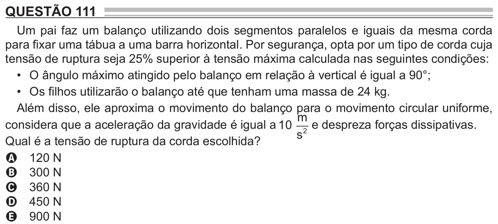

Texto extraído (pode conter ruído)

QUESTÃO 111  
Um pai faz um balanço utilizando dois segmentos paralelos e iguais da mesma corda  
para fixar uma tábua a uma barra horizontal. Por segurança, opta por um tipo de corda cuja  
tensão de ruptura seja 25% superior à tensão máxima calculada nas seguintes condições:  
• O ângulo máximo atingido pelo balanço em relação à vertical é igual a 90°;  
• Os filhos utilizarão o balanço até que tenham uma massa de 24 kg.  
Além disso, ele aproxima o movimento do balanço para o movimento circular uniforme,  
m  
considera que a aceleração da gravidade é igual a 10 2 e despreza forças dissipativas.  
s  
Qual é a tensão de ruptura da corda escolhida?  
A 120 N  
B 300 N  
C 360 N  
D 450 N  
E 900 N

