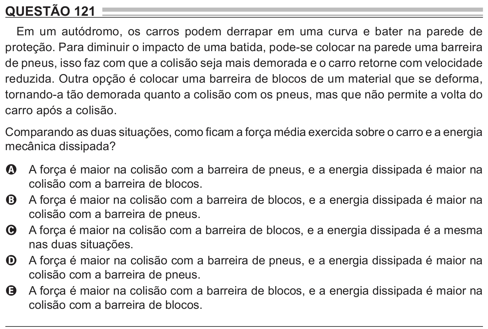

Texto extraído (pode conter ruído)

QUESTÃO 121  
Em um autódromo, os carros podem derrapar em uma curva e bater na parede de  
proteção. Para diminuir o impacto de uma batida, pode-se colocar na parede uma barreira  
de pneus, isso faz com que a colisão seja mais demorada e o carro retorne com velocidade  
reduzida. Outra opção é colocar uma barreira de blocos de um material que se deforma,  
tornando-a tão demorada quanto a colisão com os pneus, mas que não permite a volta do  
carro após a colisão.  
Comparando as duas situações, como ficam a força média exercida sobre o carro e a energia  
mecânica dissipada?  
 força é maior na colisão com a barreira de pneus, e a energia dissipada é maior na  
A  
A  
colisão com a barreira de blocos.  
A força é maior na colisão com a barreira de blocos, e a energia dissipada é maior na  
B  
colisão com a barreira de pneus.  
A força é maior na colisão com a barreira de blocos, e a energia dissipada é a mesma  
C  
nas duas situações.  
A força é maior na colisão com a barreira de pneus, e a energia dissipada é maior na  
D  
colisão com a barreira de pneus.  
A força é maior na colisão com a barreira de blocos, e a energia dissipada é maior na  
E  
colisão com a barreira de blocos.

