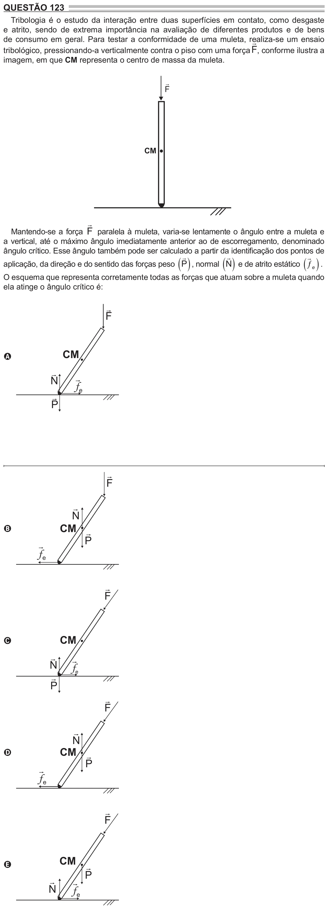

Texto extraído (pode conter ruído)

QUESTÃO 123  
Tribologia é o estudo da interação entre duas superfícies em contato, como desgaste  
e atrito, sendo de extrema importância na avaliação de diferentes produtos e de bens  
de consumo em geral. Para testar a conformidade de uma muleta, realiza-se  
um ensaio  
  
tribológico, pressionando-a verticalmente contra o piso com uma força F , conforme ilustra a  
imagem, em que CM representa o centro de massa da muleta.  
  
F  
CM  
  
Mantendo-se a força F paralela à muleta, varia-se lentamente o ângulo entre a muleta e  
a vertical, até o máximo ângulo imediatamente anterior ao de escorregamento, denominado  
ângulo crítico. Esse ângulo também pode ser calculado a partir da identificação dos pontos de  
  
  
  
   
   
   
aplicação, da direção e do sentido das forças peso P , normal N e de atrito estático  e .  
O esquema que representa corretamente todas as forças que atuam sobre a muleta quando  
ela atinge o ângulo crítico é:  
  
F  
CM  
A  
  
  
N  
f e  
  
P  
  
F  
  
N  
CM   
B  
P  
  
f e  
  
F  
CM  
C  
  
  
N  
f e  
  
P  
  
F  
  
N  
CM   
D  
P  
  
f e  
  
F  
CM   
E  
P  
  
  
N  
f e

