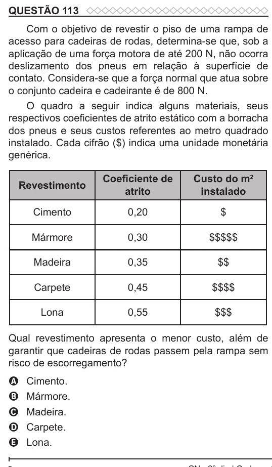

Texto extraído (pode conter ruído)

QUESTÃO 113  
Com o objetivo de revestir o piso de uma rampa de  
acesso para cadeiras de rodas, determina-se que, sob a  
aplicação de uma força motora de até 200 N, não ocorra  
deslizamento dos pneus em relação à superfície de  
contato. Considera-se que a força normal que atua sobre  
o conjunto cadeira e cadeirante é de 800 N.  
O quadro a seguir indica alguns materiais, seus  
respectivos coeficientes de atrito estático com a borracha  
dos pneus e seus custos referentes ao metro quadrado  
instalado. Cada cifrão ($) indica uma unidade monetária  
genérica.  
Coefi ciente de  
Custo do m 2  
Revestimento  
atrito  
instalado  
Cimento  
0,20  
$  
Mármore  
0,30  
$$$$$  
Madeira  
0,35  
$$  
Carpete  
0,45  
$$$$  
Lona  
0,55  
$$$  
Qual revestimento apresenta o menor custo, além de  
garantir que cadeiras de rodas passem pela rampa sem  
risco de escorregamento?  
Cimento.  
A  
Mármore.  
B  
Madeira.  
C  
Carpete.  
D  
Lona.  
E

