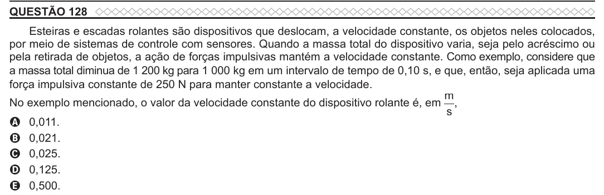

Texto extraído (pode conter ruído)

QUESTÃO 128  
Esteiras e escadas rolantes são dispositivos que deslocam, a velocidade constante, os objetos neles colocados,  
por meio de sistemas de controle com sensores. Quando a massa total do dispositivo varia, seja pelo acréscimo ou  
pela retirada de objetos, a ação de forças impulsivas mantém a velocidade constante. Como exemplo, considere que  
a massa total diminua de 1 200 kg para 1 000 kg em um intervalo de tempo de 0,10 s, e que, então, seja aplicada uma  
força impulsiva constante de 250 N para manter constante a velocidade.  
m  
No exemplo mencionado, o valor da velocidade constante do dispositivo rolante é, em ,  
s  
A 0,011.  
B 0,021.  
C 0,025.  
D 0,125.  
E 0,500.

