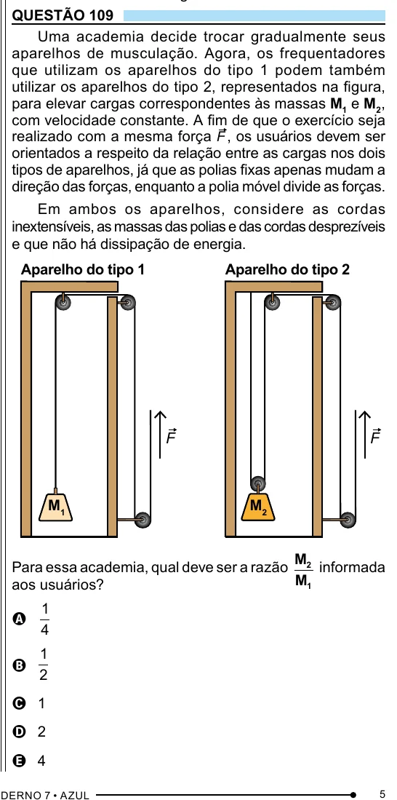

Texto extraído (pode conter ruído)

QUESTÃO 109  
Uma academia decide trocar gradualmente seus  
aparelhos de musculação. Agora, os frequentadores  
que utilizam os aparelhos do tipo 1 podem também  
utilizar os aparelhos do tipo 2, representados na figura,  
para elevar cargas correspondentes às massas M 1 e M 2 ,  
com velocidade constante. A fim de que o exercício seja  
realizado com a mesma força F , os usuários devem ser  
orientados a respeito da relação entre as cargas nos dois  
tipos de aparelhos, já que as polias fixas apenas mudam a  
direção das forças, enquanto a polia móvel divide as forças.  
Em ambos os aparelhos, considere as cordas  
inextensíveis, as massas das polias e das cordas desprezíveis  
e que não há dissipação de energia.  
Aparelho do tipo 1  
Aparelho do tipo 2  
F  
F  
M 1  
M 2  
M  
Para essa academia, qual deve ser a razão 2 informada  
M 1  
aos usuários?  
1  
A  
4  
1  
B  
2  
C 1  
D 2  
E 4  
5

