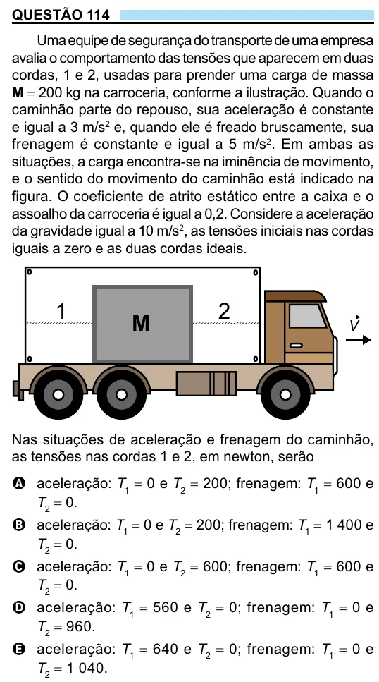

Texto extraído (pode conter ruído)

QUESTÃO 114  
Uma equipe de segurança do transporte de uma empresa  
avalia o comportamento das tensões que aparecem em duas  
cordas, 1 e 2, usadas para prender uma carga de massa  
M = 200 kg na carroceria, conforme a ilustração. Quando o  
caminhão parte do repouso, sua aceleração é constante  
e igual a 3 m/s 2 e, quando ele é freado bruscamente, sua  
frenagem é constante e igual a 5 m/s 2 . Em ambas as  
situações, a carga encontra-se na iminência de movimento,  
e o sentido do movimento do caminhão está indicado na  
figura. O coeficiente de atrito estático entre a caixa e o  
assoalho da carroceria é igual a 0,2. Considere a aceleração  
da gravidade igual a 10 m/s 2 , as tensões iniciais nas cordas  
iguais a zero e as duas cordas ideais.  
1  
2  
M  
V  
Nas situações de aceleração e frenagem do caminhão,  
as tensões nas cordas 1 e 2, em newton, serão  
A aceleração: T 1 = 0 e T 2 = 200; frenagem: T 1 = 600 e  
T 2 = 0.  
B aceleração: T 1 = 0 e T 2 = 200; frenagem: T 1 = 1 400 e  
T 2 = 0.  
C aceleração: T 1 = 0 e T 2 = 600; frenagem: T 1 = 600 e  
T 2 = 0.  
D aceleração: T 1 = 560 e T 2 = 0; frenagem: T 1 = 0 e  
T 2 = 960.  
E aceleração: T 1 = 640 e T 2 = 0; frenagem: T 1 = 0 e  
T 2 = 1 040.

