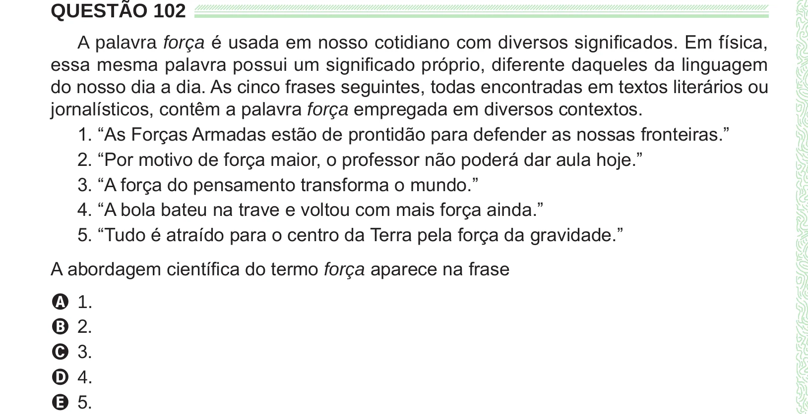

Texto extraído (pode conter ruído)

QUESTÃO 102  
A palavra força é usada em nosso cotidiano com diversos significados. Em física,  
essa mesma palavra possui um significado próprio, diferente daqueles da linguagem  
do nosso dia a dia. As cinco frases seguintes, todas encontradas em textos literários ou  
jornalísticos, contêm a palavra força empregada em diversos contextos.  
1. “As Forças Armadas estão de prontidão para defender as nossas fronteiras.”  
2. “Por motivo de força maior, o professor não poderá dar aula hoje.”  
3. “A força do pensamento transforma o mundo.”  
4. “A bola bateu na trave e voltou com mais força ainda.”  
5. “Tudo é atraído para o centro da Terra pela força da gravidade.”  
A abordagem científica do termo força aparece na frase  
A 1.  
B 2.  
C 3.  
D 4.  
E 5.

