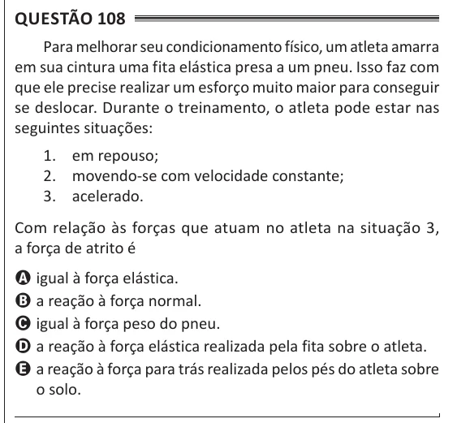

Texto extraído (pode conter ruído)

Questão 108  
Para melhorar seu condicionamento físico, um atleta amarra  
em sua cintura uma fita elástica presa a um pneu. Isso faz com  
que ele precise realizar um esforço muito maior para conseguir  
se deslocar. Durante o treinamento, o atleta pode estar nas  
seguintes situações:  
1. em repouso;  
2. movendo-se com velocidade constante;  
3. acelerado.  
Com relação às forças que atuam no atleta na situação 3,  
a força de atrito é  
A igual à força elástica.  
B a reação à força normal.  
C igual à força peso do pneu.  
D a reação à força elástica realizada pela fita sobre o atleta.  
E a reação à força para trás realizada pelos pés do atleta sobre  
o solo.

