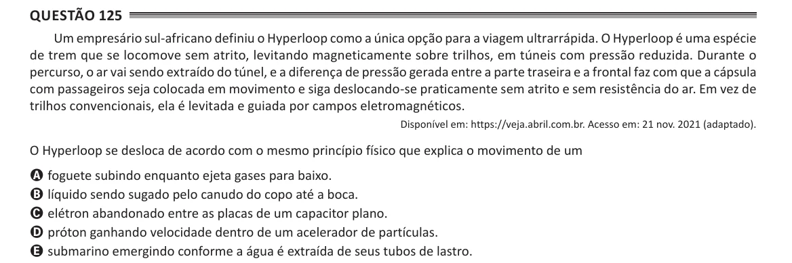

Texto extraído (pode conter ruído)

Questão 125  
Um empresário sul-africano definiu o Hyperloop como a única opção para a viagem ultrarrápida. O Hyperloop é uma espécie  
de trem que se locomove sem atrito, levitando magneticamente sobre trilhos, em túneis com pressão reduzida. Durante o  
percurso, o ar vai sendo extraído do túnel, e a diferença de pressão gerada entre a parte traseira e a frontal faz com que a cápsula  
com passageiros seja colocada em movimento e siga deslocando-se praticamente sem atrito e sem resistência do ar. Em vez de  
trilhos convencionais, ela é levitada e guiada por campos eletromagnéticos.  
Disponível em: https://veja.abril.com.br. Acesso em: 21 nov. 2021 (adaptado).  
O Hyperloop se desloca de acordo com o mesmo princípio físico que explica o movimento de um  
A foguete subindo enquanto ejeta gases para baixo.  
B líquido sendo sugado pelo canudo do copo até a boca.  
C elétron abandonado entre as placas de um capacitor plano.  
D próton ganhando velocidade dentro de um acelerador de partículas.  
E submarino emergindo conforme a água é extraída de seus tubos de lastro.

