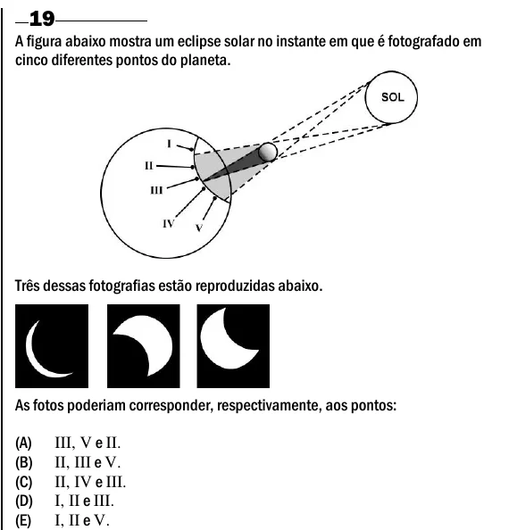

Texto extraído (pode conter ruído)

19  
A figura abaixo mostra um eclipse solar no instante em que é fotografado em  
cinco diferentes pontos do planeta.  
Três dessas fotografias estão reproduzidas abaixo.  
As fotos poderiam corresponder, respectivamente, aos pontos:  
(A)  
III, V e II.  
(B)  
II, III e V.  
(C)  
II, IV e III.  
(D)  
I, II e III.  
(E)  
I, II e V.

