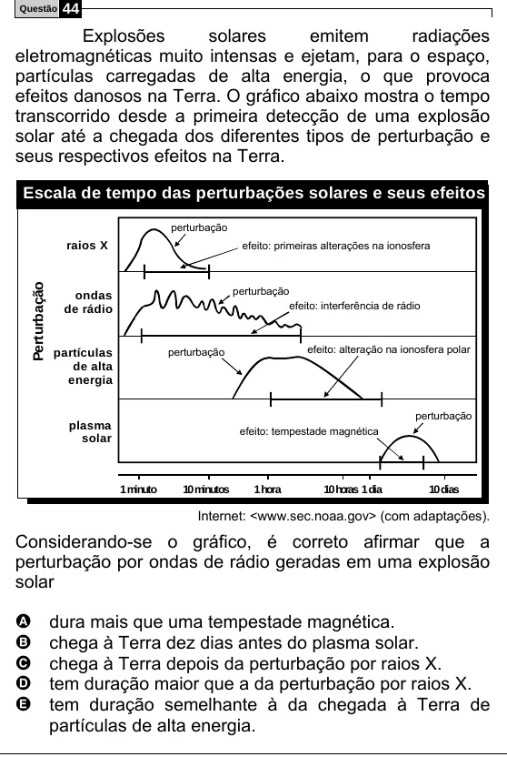

Texto extraído (pode conter ruído)

Questão  
44  
Explosões  
solares  
emitem  
radiações  
eletromagnéticas muito intensas e ejetam, para o espaço,  
partículas carregadas de alta energia, o que provoca  
efeitos danosos na Terra. O gráfico abaixo mostra o tempo  
transcorrido desde a primeira detecção de uma explosão  
solar até a chegada dos diferentes tipos de perturbação e  
seus respectivos efeitos na Terra.  
Escala de tempo das perturbações solares e seus efeitos  
perturbação  
raios X  
efeito: primeiras alterações na ionosfera  
Perturbação  
perturbação  
ondas  
de rádio  
efeito: interferência de rádio  
efeito: alteração na ionosfera polar  
partículas  
perturbação  
de alta  
energia  
perturbação  
plasma  
efeito: tempestade magnética  
solar  
1 minuto  
10 minutos  
1 hora  
10 horas 1 dia  
10 dias  
Internet: <www.sec.noaa.gov> (com adaptações).  
Considerando-se o gráfico, é correto afirmar que a  
perturbação por ondas de rádio geradas em uma explosão  
solar  
dura mais que uma tempestade magnética.  
A  
chega à Terra dez dias antes do plasma solar.  
B  
C  
chega à Terra depois da perturbação por raios X.  
tem duração maior que a da perturbação por raios X.  
D  
tem duração semelhante à da chegada à Terra de  
E  
partículas de alta energia.

