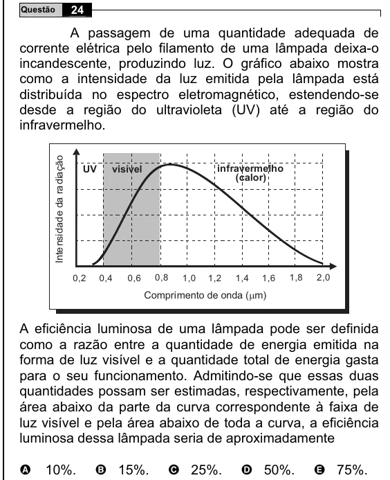

Texto extraído (pode conter ruído)

24  
Questão  
A passagem de uma quantidade adequada de  
corrente elétrica pelo filamento de uma lâmpada deixa-o  
incandescente, produzindo luz. O gráfico abaixo mostra  
como a intensidade da luz emitida pela lâmpada está  
distribuída no espectro eletromagnético, estendendo-se  
desde a região do ultravioleta (UV) até a região do  
infravermelho.  
Intensidade da radiação  
UV  
visível  
infravermelho  
(calor)  
0,8  
1,8  
2,0  
0,2  
0,4  
0,6  
1,0  
1,2  
1,4  
1,6  
Comprimento de onda ( P m)  
A eficiência luminosa de uma lâmpada pode ser definida  
como a razão entre a quantidade de energia emitida na  
forma de luz visível e a quantidade total de energia gasta  
para o seu funcionamento. Admitindo-se que essas duas  
quantidades possam ser estimadas, respectivamente, pela  
área abaixo da parte da curva correspondente à faixa de  
luz visível e pela área abaixo de toda a curva, a eficiência  
luminosa dessa lâmpada seria de aproximadamente  
10%.  
B 15%.  
C 25%.  
D 50%.  
E 75%.  
A

