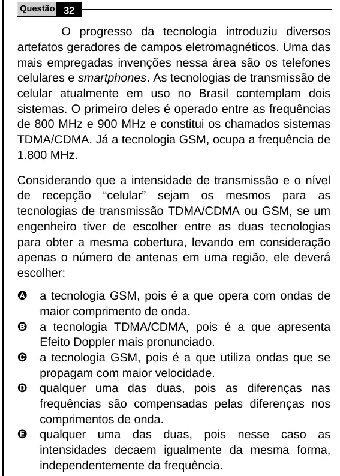

Texto extraído (pode conter ruído)

Questão 32  
O progresso da tecnologia introduziu diversos  
artefatos geradores de campos eletromagnéticos. Uma das  
mais empregadas invenções nessa área são os telefones  
celulares e smartphones. As tecnologias de transmissão de  
celular atualmente em uso no Brasil contemplam dois  
sistemas. O primeiro deles é operado entre as frequências  
de 800 MHz e 900 MHz e constitui os chamados sistemas  
TDMA/CDMA. Já a tecnologia GSM, ocupa a frequência de  
1.800 MHz.  
Considerando que a intensidade de transmissão e o nível  
de recepção “celular” sejam os mesmos para as  
tecnologias de transmissão TDMA/CDMA ou GSM, se um  
engenheiro tiver de escolher entre as duas tecnologias  
para obter a mesma cobertura, levando em consideração  
apenas o número de antenas em uma região, ele deverá  
escolher:  
A  
a tecnologia GSM, pois é a que opera com ondas de  
maior comprimento de onda.  
B  
a tecnologia TDMA/CDMA, pois é a que apresenta  
Efeito Doppler mais pronunciado.  
C  
a tecnologia GSM, pois é a que utiliza ondas que se  
propagam com maior velocidade.  
D  
qualquer uma das duas, pois as diferenças nas  
frequências são compensadas pelas diferenças nos  
comprimentos de onda.  
E  
qualquer uma das duas, pois nesse caso as  
intensidades decaem igualmente da mesma forma,  
independentemente da frequência.

