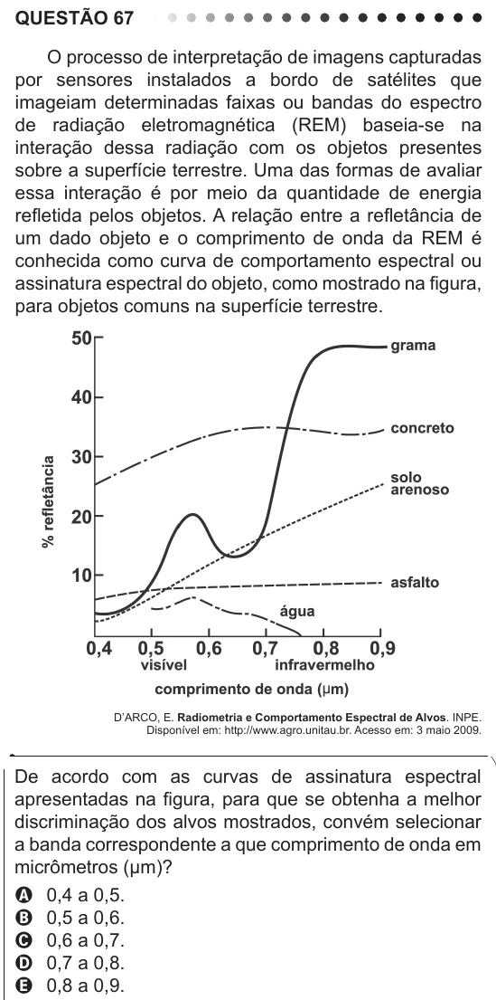

Texto extraído (pode conter ruído)

QUESTÃO 67  
O processo de interpretação de imagens capturadas  
por sensores instalados a bordo de satélites que  
imageiam determinadas faixas ou bandas do espectro  
de radiação eletromagnética (REM) baseia-se na  
interação dessa radiação com os objetos presentes  
sobre a superfície terrestre. Uma das formas de avaliar  
essa interação é por meio da quantidade de energia  
refletida pelos objetos. A relação entre a refletância de  
um dado objeto e o comprimento de onda da REM é  
conhecida como curva de comportamento espectral ou  
assinatura espectral do objeto, como mostrado na figura,  
para objetos comuns na superfície terrestre.  
D’ARCO, E. Radiometria e Comportamento Espectral de Alvos. INPE.  
Disponível em: http://www.agro.unitau.br. Acesso em: 3 maio 2009.  
De acordo com as curvas de assinatura espectral  
apresentadas na figura, para que se obtenha a melhor  
discriminação dos alvos mostrados, convém selecionar  
a banda correspondente a que comprimento de onda em  
micrômetros (µm)?  
A 0,4 a 0,5.  
B 0,5 a 0,6.  
C 0,6 a 0,7.  
D 0,7 a 0,8.  
E 0,8 a 0,9.

