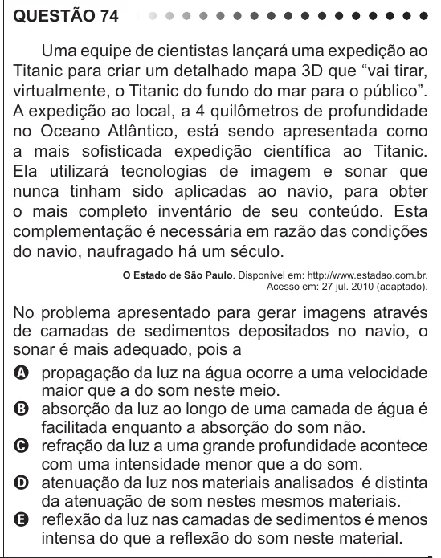

Texto extraído (pode conter ruído)

QUESTÃO 74  
Uma equipe de cientistas lançará uma expedição ao  
Titanic para criar um detalhado mapa 3D que “vai tirar,  
virtualmente, o Titanic do fundo do mar para o público”.  
A expedição ao local, a 4 quilômetros de profundidade  
no Oceano Atlântico, está sendo apresentada como  
a mais sofisticada expedição científica ao Titanic.  
Ela utilizará tecnologias de imagem e sonar que  
nunca tinham sido aplicadas ao navio, para obter  
o mais completo inventário de seu conteúdo. Esta  
complementação é necessária em razão das condições  
do navio, naufragado há um século.  
O Estado de São Paulo. Disponível em: http://www.estadao.com.br.  
Acesso em: 27 jul. 2010 (adaptado).  
No problema apresentado para gerar imagens através  
de camadas de sedimentos depositados no navio, o  
sonar é mais adequado, pois a  
A propagação da luz na água ocorre a uma velocidade  
maior que a do som neste meio.  
B absorção da luz ao longo de uma camada de água é  
facilitada enquanto a absorção do som não.  
C refração da luz a uma grande profundidade acontece  
com uma intensidade menor que a do som.  
D atenuação da luz nos materiais analisados é distinta  
da atenuação de som nestes mesmos materiais.  
E reflexão da luz nas camadas de sedimentos é menos  
intensa do que a reflexão do som neste material.

