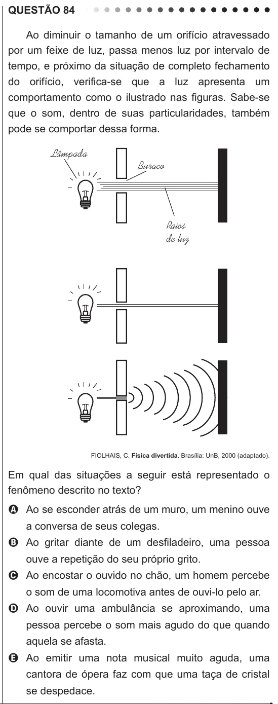

Texto extraído (pode conter ruído)

QUESTÃO 84  
Ao diminuir o tamanho de um orifício atravessado  
por um feixe de luz, passa menos luz por intervalo de  
tempo, e próximo da situação de completo fechamento  
do orifício, verifica-se que a luz apresenta um  
comportamento como o ilustrado nas figuras. Sabe-se  
que o som, dentro de suas particularidades, também  
pode se comportar dessa forma.  
Lâmpada  
Buraco  
Raios  
de luz  
FIOLHAIS, C. Física divertida. Brasília: UnB, 2000 (adaptado).  
Em qual das situações a seguir está representado o  
fenômeno descrito no texto?  
A Ao se esconder atrás de um muro, um menino ouve  
a conversa de seus colegas.  
B Ao gritar diante de um desfiladeiro, uma pessoa  
ouve a repetição do seu próprio grito.  
C Ao encostar o ouvido no chão, um homem percebe  
o som de uma locomotiva antes de ouvi-lo pelo ar.  
D Ao ouvir uma ambulância se aproximando, uma  
pessoa percebe o som mais agudo do que quando  
aquela se afasta.  
E Ao emitir uma nota musical muito aguda, uma  
cantora de ópera faz com que uma taça de cristal  
se despedace.

