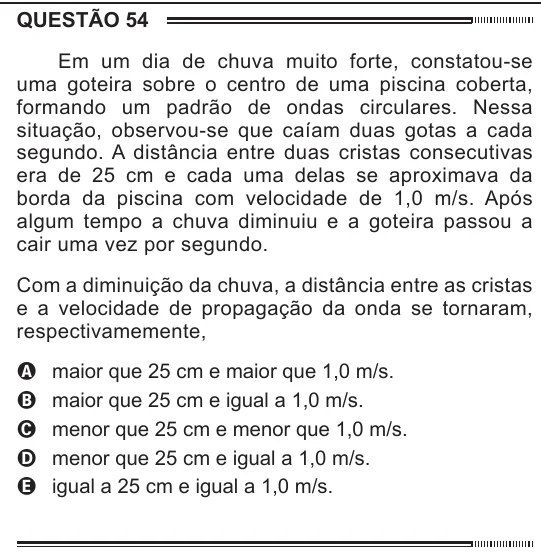

Texto extraído (pode conter ruído)

QUESTÃO 54  
Em um dia de chuva muito forte, constatou-se  
uma goteira sobre o centro de uma piscina coberta,  
formando um padrão de ondas circulares. Nessa  
situação, observou-se que caíam duas gotas a cada  
segundo. A distância entre duas cristas consecutivas  
era de 25 cm e cada uma delas se aproximava da  
borda da piscina com velocidade de 1,0 m/s. Após  
algum tempo a chuva diminuiu e a goteira passou a  
cair uma vez por segundo.  
Com a diminuição da chuva, a distância entre as cristas  
e a velocidade de propagação da onda se tornaram,  
respectivamemente,  
maior que 25 cm e maior que 1,0 m/s.  
A  
maior que 25 cm e igual a 1,0 m/s.  
B  
C  
menor que 25 cm e menor que 1,0 m/s.  
menor que 25 cm e igual a 1,0 m/s.  
D  
E  
igual a 25 cm e igual a 1,0 m/s.

