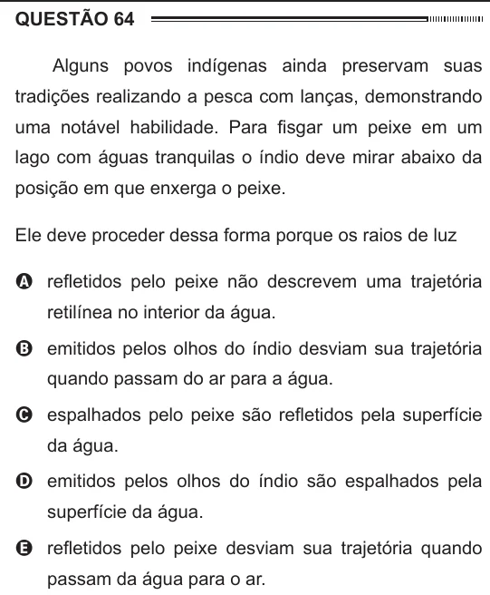

Texto extraído (pode conter ruído)

QUESTÃO 64  
Alguns povos indígenas ainda preservam suas  
tradições realizando a pesca com lanças, demonstrando  
uma notável habilidade. Para fisgar um peixe em um  
lago com águas tranquilas o índio deve mirar abaixo da  
posição em que enxerga o peixe.  
Ele deve proceder dessa forma porque os raios de luz  
A refletidos pelo peixe não descrevem uma trajetória  
retilínea no interior da água.  
B emitidos pelos olhos do índio desviam sua trajetória  
quando passam do ar para a água.  
C espalhados pelo peixe são refletidos pela superfície  
da água.  
D emitidos pelos olhos do índio são espalhados pela  
superfície da água.  
E refletidos pelo peixe desviam sua trajetória quando  
passam da água para o ar.

