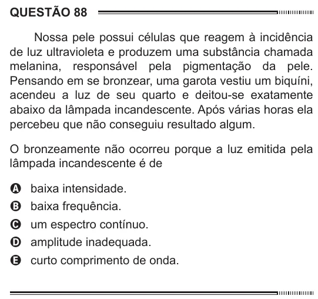

Texto extraído (pode conter ruído)

QUESTÃO 88  
Nossa pele possui células que reagem à incidência  
de luz ultravioleta e produzem uma substância chamada  
melanina, responsável pela pigmentação da pele.  
Pensando em se bronzear, uma garota vestiu um biquíni,  
acendeu a luz de seu quarto e deitou-se exatamente  
abaixo da lâmpada incandescente. Após várias horas ela  
percebeu que não conseguiu resultado algum.  
O bronzeamente não ocorreu porque a luz emitida pela  
lâmpada incandescente é de  
A baixa intensidade.  
B baixa frequência.  
C um espectro contínuo.  
D amplitude inadequada.  
E curto comprimento de onda.

