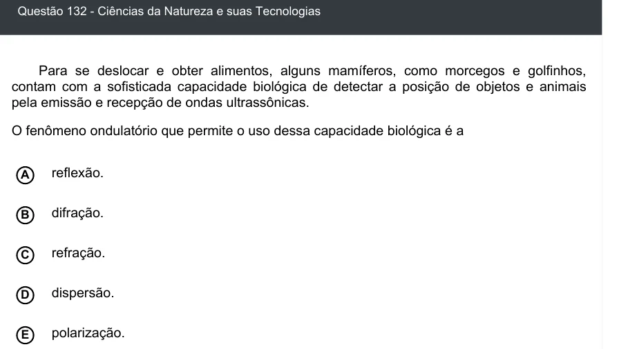

Texto extraído (pode conter ruído)

Questão 132 - Ciências da Natureza e suas Tecnologias  
Para se deslocar e obter alimentos, alguns mamíferos, como morcegos e golfinhos,  
contam com a sofisticada capacidade biológica de detectar a posição de objetos e animais  
pela emissão e recepção de ondas ultrassônicas.  
O fenômeno ondulatório que permite o uso dessa capacidade biológica é a  
reflexão.  
A  
B  
difração.  
refração.  
C  
dispersão.  
D  
E  
polarização.

