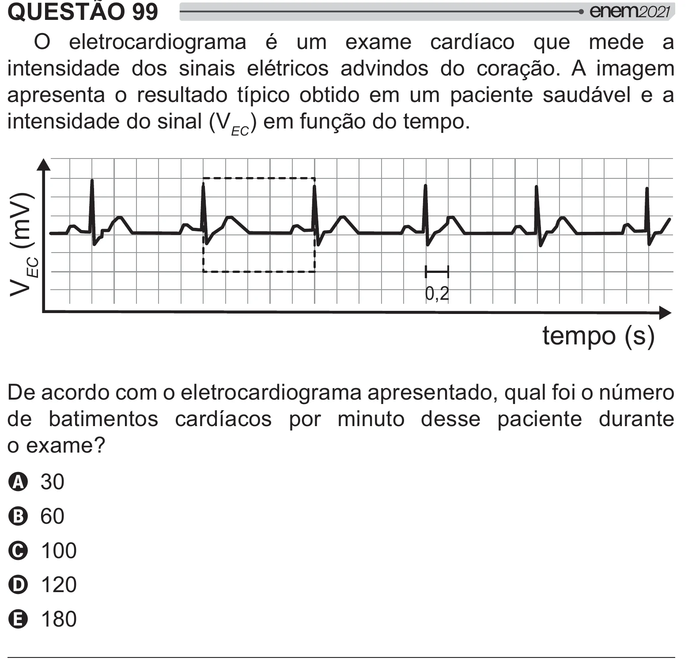

Texto extraído (pode conter ruído)

QUESTÃO 99  
O eletrocardiograma é um exame cardíaco que mede a  
intensidade dos sinais elétricos advindos do coração. A imagem  
apresenta o resultado típico obtido em um paciente saudável e a  
intensidade do sinal (V  ) em função do tempo.  
V EC (mV)  
0,2  
tempo (s)  
De acordo com o eletrocardiograma apresentado, qual foi o número  
de batimentos cardíacos por minuto desse paciente durante  
 * ]  
A 30  
B 60  
C 100  
D 120  
E 180

