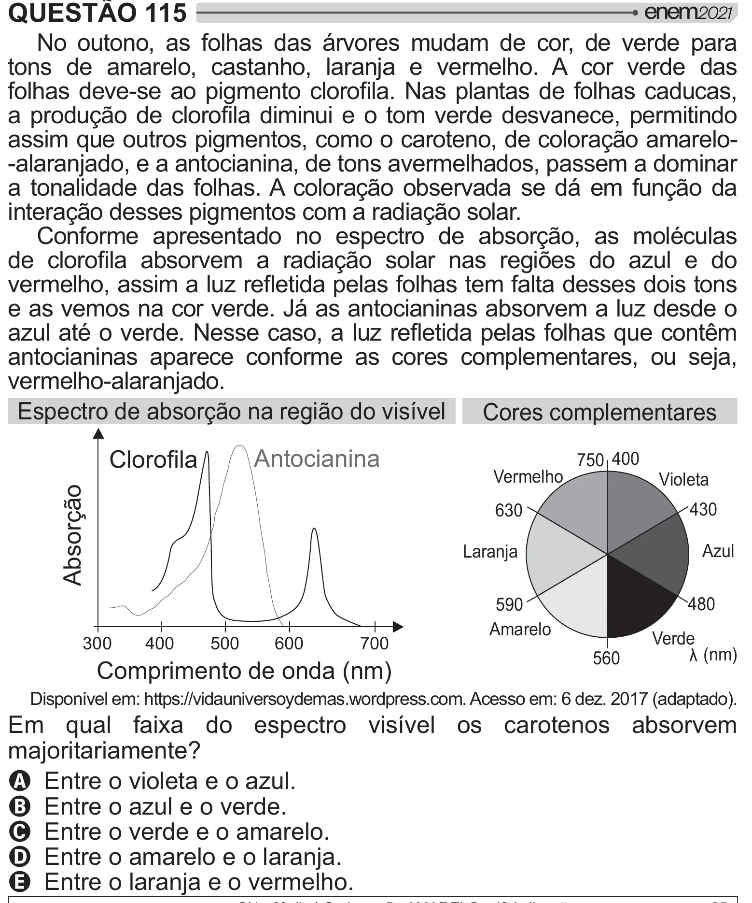

Texto extraído (pode conter ruído)

QUESTÃO 115  
No outono, as folhas das árvores mudam de cor, de verde para  
tons de amarelo, castanho, laranja e vermelho. A cor verde das  
>$   "    #   ! ˆ  #     >$      
 # =[         "    "   #    
assim que outros pigmentos, como o caroteno, de coloração amarelo-  
-alaranjado, e a antocianina, de tons avermelhados, passem a dominar  
a tonalidade das folhas. A coloração observada se dá em função da  
interação desses pigmentos com a radiação solar.  
Conforme apresentado no espectro de absorção, as moléculas  
   y "   =[             
"  $   } #  >$  >   
     
e as vemos na cor verde. Já as antocianinas absorvem a luz desde o  
  <"  !ˆ  
   } #  >$   
 +  
antocianinas aparece conforme as cores complementares, ou seja,  
vermelho-alaranjado.  
Espectro de absorção na região do visível  
Cores complementares  
Antocianina  
Clorofila  
750 400  
Vermelho  
Violeta  
Absorção  
630  
430  
Laranja  
Azul  
480  
590  
Amarelo  
Verde  
300  
400  
500  
600  
700  
¥ (nm)  
560  
Comprimento de onda (nm)  
Disponível em: https://vidauniversoydemas.wordpress.com. Acesso em: 6 dez. 2017 (adaptado).  
Em qual faixa do espectro visível os carotenos absorvem  
‡   ]  
A Entre o violeta e o azul.  
B Entre o azul e o verde.  
C Entre o verde e o amarelo.  
D Entre o amarelo e o laranja.  
E Entre o laranja e o vermelho.

