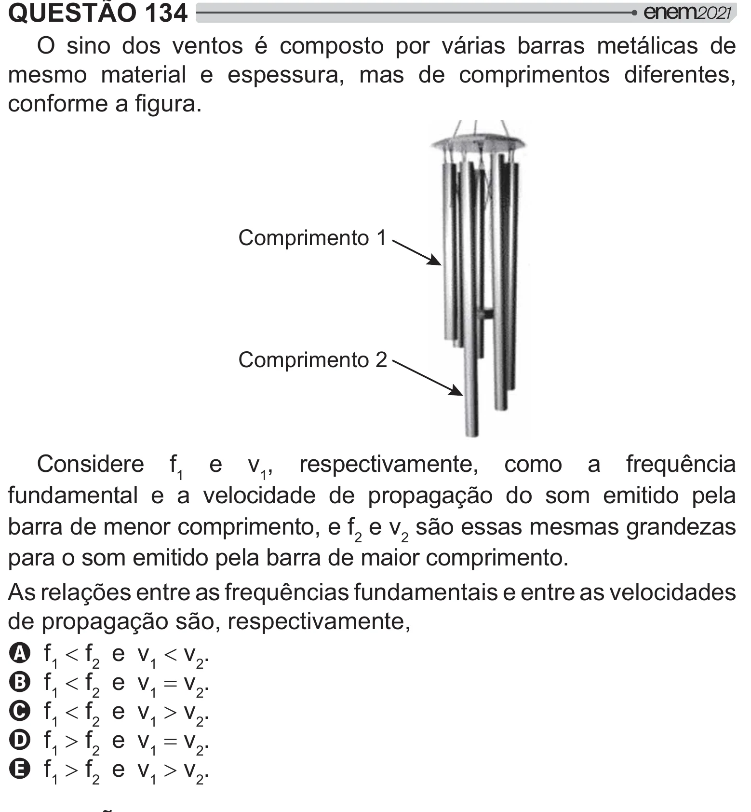

Texto extraído (pode conter ruído)

QUESTÃO 134  
O sino dos ventos é composto por várias barras metálicas de  
mesmo material e espessura, mas de comprimentos diferentes,  
>  !  
Comprimento 1  
Comprimento 2  
Considere f 1 e v 1 , respectivamente, como a frequência  
fundamental e a velocidade de propagação do som emitido pela  
barra de menor comprimento, e f 2 e v 2 são essas mesmas grandezas  
para o som emitido pela barra de maior comprimento.  
As relações entre as frequências fundamentais e entre as velocidades  
de propagação são, respectivamente,  
A f 1  f 2 e v 1  v 2 .  
B f 1  f 2 e v 1 v 2 .  
C f 1  f 2 e v 1 ! v 2 .  
D f 1 ! f 2 e v 1 v 2 .  
E f 1 ! f 2 e v 1 ! v 2 .

