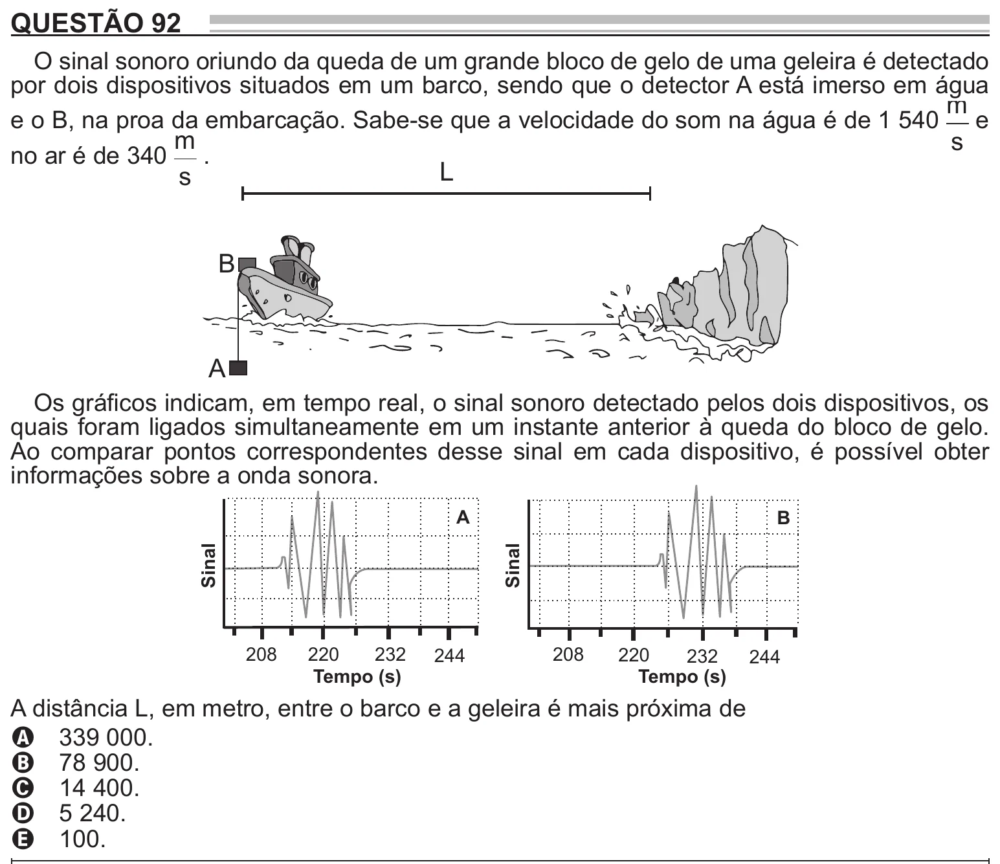

Texto extraído (pode conter ruído)

QUESTÃO 92  
O sinal sonoro oriundo da queda de um grande bloco de gelo de uma geleira é detectado  
por dois dispositivos situados em um barco, sendo que o detector A está imerso em água  
m  
e o B, na proa da embarcação. Sabe-se que a velocidade do som na água é de 1 540  
e  
m  
s  
no ar é de 340 .  
L  
s  
B  
A  
Os gráficos indicam, em tempo real, o sinal sonoro detectado pelos dois dispositivos, os  
quais foram ligados simultaneamente em um instante anterior à queda do bloco de gelo.  
Ao comparar pontos correspondentes desse sinal em cada dispositivo, é possível obter  
informações sobre a onda sonora.  
A  
B  
Sinal  
Sinal  
208  
220  
232  
244  
208  
220  
232  
244  
Tempo (s)  
Tempo (s)  
A distância L, em metro, entre o barco e a geleira é mais próxima de  
A 339 000.  
B 78 900.  
C 14 400.  
D 5 240.  
E 100.

