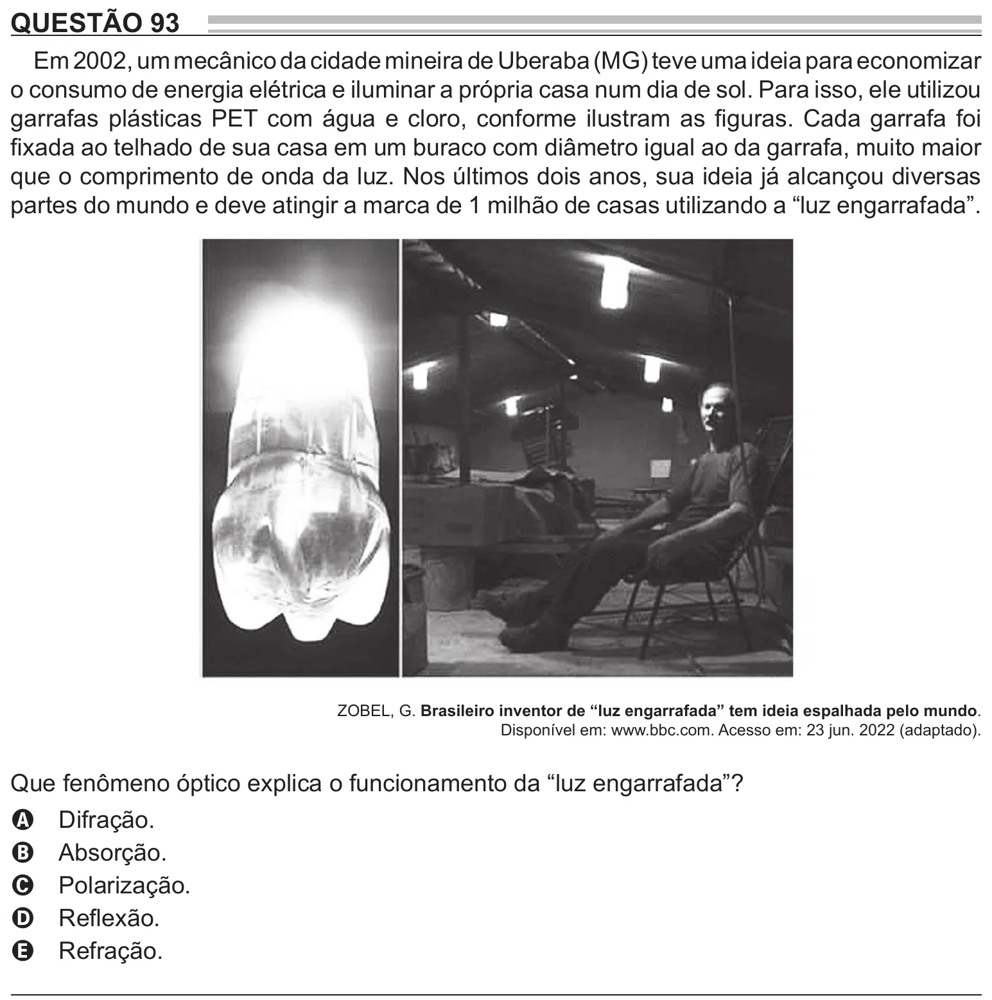

Texto extraído (pode conter ruído)

QUESTÃO 93  
Em 2002, um mecânico da cidade mineira de Uberaba (MG) teve uma ideia para economizar  
o consumo de energia elétrica e iluminar a própria casa num dia de sol. Para isso, ele utilizou  
garrafas plásticas PET com água e cloro, conforme ilustram as figuras. Cada garrafa foi  
fixada ao telhado de sua casa em um buraco com diâmetro igual ao da garrafa, muito maior  
que o comprimento de onda da luz. Nos últimos dois anos, sua ideia já alcançou diversas  
partes do mundo e deve atingir a marca de 1 milhão de casas utilizando a “luz engarrafada”.  
ZOBEL, G. Brasileiro inventor de “luz engarrafada” tem ideia espalhada pelo mundo.  
Disponível em: www.bbc.com. Acesso em: 23 jun. 2022 (adaptado).  
Que fenômeno óptico explica o funcionamento da “luz engarrafada”?  
Difração.  
A  
Absorção.  
B  
Polarização.  
C  
Reflexão.  
D  
Refração.  
E

