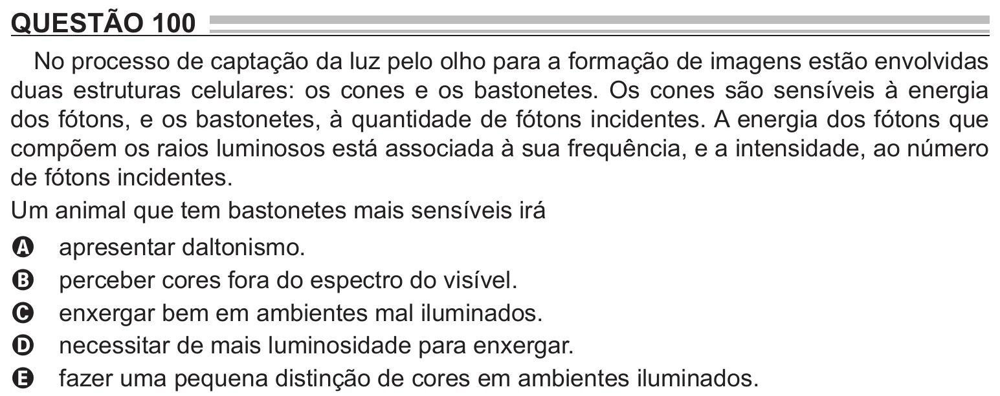

Texto extraído (pode conter ruído)

QUESTÃO 100  
No processo de captação da luz pelo olho para a formação de imagens estão envolvidas  
duas estruturas celulares: os cones e os bastonetes. Os cones são sensíveis à energia  
dos fótons, e os bastonetes, à quantidade de fótons incidentes. A energia dos fótons que  
compõem os raios luminosos está associada à sua frequência, e a intensidade, ao número  
de fótons incidentes.  
Um animal que tem bastonetes mais sensíveis irá  
apresentar daltonismo.  
A  
perceber cores fora do espectro do visível.  
B  
enxergar bem em ambientes mal iluminados.  
C  
necessitar de mais luminosidade para enxergar.  
D  
fazer uma pequena distinção de cores em ambientes iluminados.  
E

