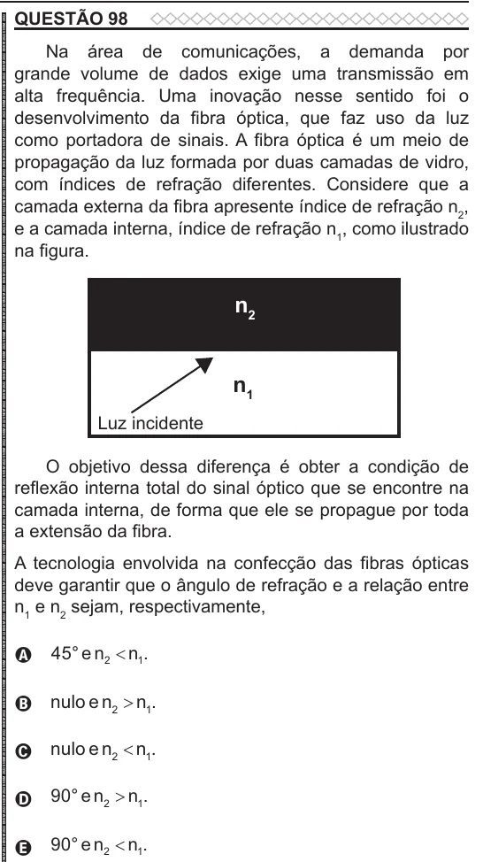

Texto extraído (pode conter ruído)

QUESTÃO 98  
Na área de comunicações, a demanda por  
grande volume de dados exige uma transmissão em  
alta frequência. Uma inovação nesse sentido foi o  
desenvolvimento da fibra óptica, que faz uso da luz  
como portadora de sinais. A fibra óptica é um meio de  
propagação da luz formada por duas camadas de vidro,  
com índices de refração diferentes. Considere que a  
camada externa da fibra apresente índice de refração n 2 ,  
e a camada interna, índice de refração n 1 , como ilustrado  
na figura.  
n 2  
n 1  
Luz incidente  
O objetivo dessa diferença é obter a condição de  
reflexão interna total do sinal óptico que se encontre na  
camada interna, de forma que ele se propague por toda  
a extensão da fibra.  
A tecnologia envolvida na confecção das fibras ópticas  
deve garantir que o ângulo de refração e a relação entre  
n 1 e n 2 sejam, respectivamente,  
45 °  e  n 2  n 1 .  
A  
nulo  e  n 2  n 1 .  
B  
nulo  e  n 2  n 1 .  
C  
90°  e  n 2  n 1 .  
D  
90°  e  n 2  n 1 .  
E

