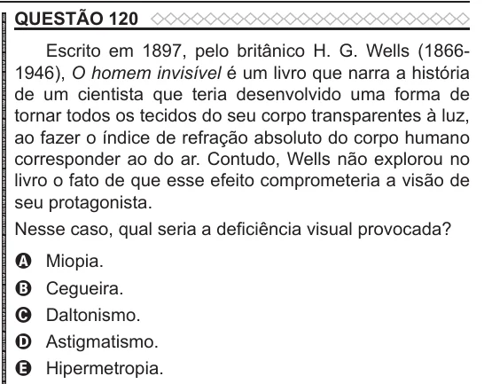

Texto extraído (pode conter ruído)

QUESTÃO 120  
Escrito em 1897, pelo britânico H. G. Wells (1866-  
1946), O homem invisível é um livro que narra a história  
de um cientista que teria desenvolvido uma forma de  
tornar todos os tecidos do seu corpo transparentes à luz,  
ao fazer o índice de refração absoluto do corpo humano  
corresponder ao do ar. Contudo, Wells não explorou no  
livro o fato de que esse efeito comprometeria a visão de  
seu protagonista.  
Nesse caso, qual seria a deficiência visual provocada?  
Miopia.  
A  
Cegueira.  
B  
Daltonismo.  
C  
Astigmatismo.  
D  
Hipermetropia.  
E

