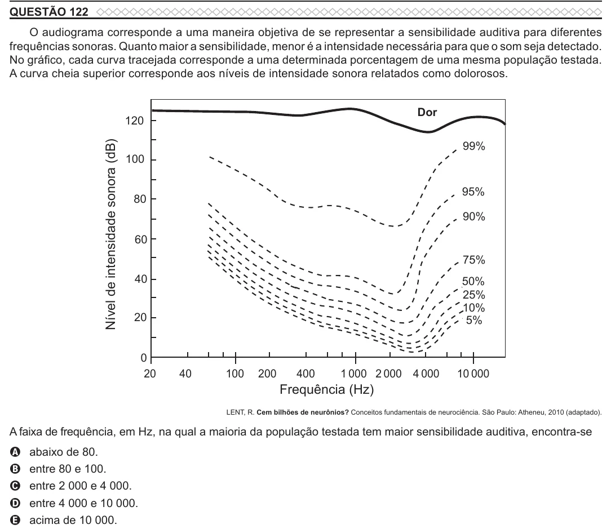

Texto extraído (pode conter ruído)

QUESTÃO 122  
O audiograma corresponde a uma maneira objetiva de se representar a sensibilidade auditiva para diferentes  
frequências sonoras. Quanto maior a sensibilidade, menor é a intensidade necessária para que o som seja detectado.  
No gráfico, cada curva tracejada corresponde a uma determinada porcentagem de uma mesma população testada.  
A curva cheia superior corresponde aos níveis de intensidade sonora relatados como dolorosos.  
Dor  
120  
Nível de intensidade sonora (dB)  
99%  
100  
95%  
80  
90%  
60  
75%  
40  
50%  
25%  
10%  
20  
5%  
0  
20  
40  
100  
200  
400  
1 000 2 000 4 000  
10 000  
Frequência (Hz)  
LENT, R. Cem bilhões de neurônios? Conceitos fundamentais de neurociência. São Paulo: Atheneu, 2010 (adaptado).  
A faixa de frequência, em Hz, na qual a maioria da população testada tem maior sensibilidade auditiva, encontra-se  
A  
abaixo de 80.  
entre 80 e 100.  
B  
entre 2 000 e 4 000.  
C  
entre 4 000 e 10 000.  
D  
acima de 10 000.  
E

