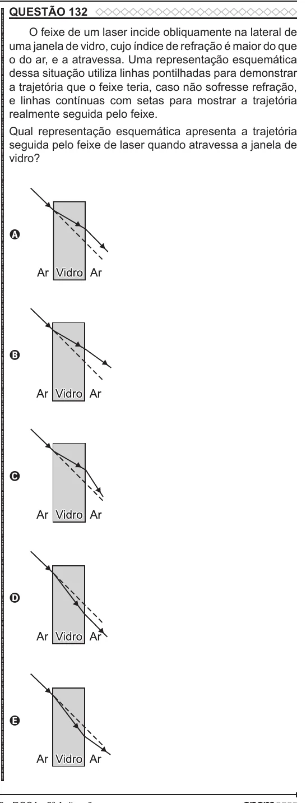

Texto extraído (pode conter ruído)

QUESTÃO 132  
ENEM 2022 ENEM 2022 ENEM 2022 ENEM 2022 ENEM 2022 ENEM 2022 ENEM 2022 ENEM 2022 ENEM 2022 ENEM 2022 ENEM 2022 ENEM 2022 ENEM 2022 ENEM 2022 ENEM 2022 ENEM 2022 ENEM 2022 ENEM 2022 ENEM 2022 ENEM 2022 ENEM 2022 ENEM 2022 ENEM 2022 ENEM 2022 ENEM 2022 ENEM 2022 ENEM 2022 ENEM 2022 ENEM 2022 ENEM 2022 ENEM 2022 ENEM 2022 ENEM 2022 ENEM 2022 ENEM 2022 ENEM 2022 ENEM 2022 ENEM 2022 ENEM 2022 ENEM 2022 ENEM 2022 ENEM 2022 ENEM 2022 ENEM 2022 ENEM 2022 ENEM 2022 ENEM 2022 ENEM 2022 ENEM 2022 ENEM 2022 ENEM 2022 ENEM 2022 ENEM 2022 ENEM 2022 ENEM 2022 ENEM 2022 ENEM 2022 ENEM 2022 ENEM 2022 ENEM 2022 ENEM 2022 ENEM 2022 ENEM 2022  
O feixe de um laser incide obliquamente na lateral de  
uma janela de vidro, cujo índice de refração é maior do que  
o do ar, e a atravessa. Uma representação esquemática  
dessa situação utiliza linhas pontilhadas para demonstrar  
a trajetória que o feixe teria, caso não sofresse refração,  
e linhas contínuas com setas para mostrar a trajetória  
realmente seguida pelo feixe.  
Qual representação esquemática apresenta a trajetória  
seguida pelo feixe de laser quando atravessa a janela de  
vidro?  
A  
B  
C  
D  
E

