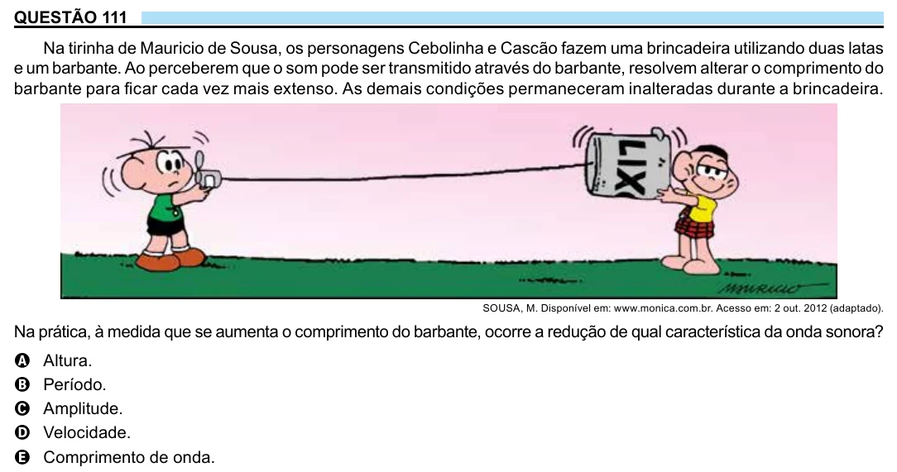

Texto extraído (pode conter ruído)

QUESTÃO 111  
Na tirinha de Mauricio de Sousa, os personagens Cebolinha e Cascão fazem uma brincadeira utilizando duas latas  
e um barbante. Ao perceberem que o som pode ser transmitido através do barbante, resolvem alterar o comprimento do  
barbante para ficar cada vez mais extenso. As demais condições permaneceram inalteradas durante a brincadeira.  
SOUSA, M. Disponível em: www.monica.com.br. Acesso em: 2 out. 2012 (adaptado).  
Na prática, à medida que se aumenta o comprimento do barbante, ocorre a redução de qual característica da onda sonora?  
Altura.  
A  
Período.  
B  
Amplitude.  
C  
Velocidade.  
D  
Comprimento de onda.  
E

