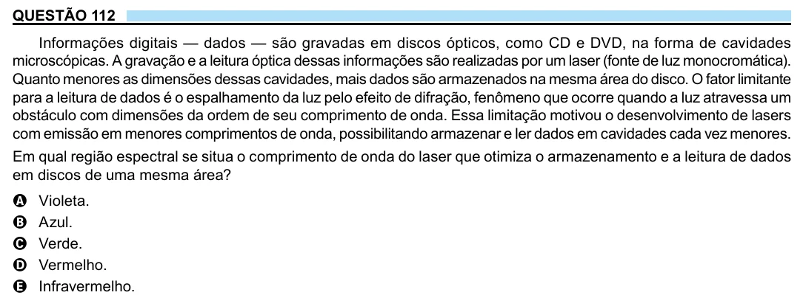

Texto extraído (pode conter ruído)

QUESTÃO 112  
Informações digitais — dados — são gravadas em discos ópticos, como CD e DVD, na forma de cavidades  
microscópicas. A gravação e a leitura óptica dessas informações são realizadas por um laser (fonte de luz monocromática).  
Quanto menores as dimensões dessas cavidades, mais dados são armazenados na mesma área do disco. O fator limitante  
para a leitura de dados é o espalhamento da luz pelo efeito de difração, fenômeno que ocorre quando a luz atravessa um  
obstáculo com dimensões da ordem de seu comprimento de onda. Essa limitação motivou o desenvolvimento de lasers  
com emissão em menores comprimentos de onda, possibilitando armazenar e ler dados em cavidades cada vez menores.  
Em qual região espectral se situa o comprimento de onda do laser que otimiza o armazenamento e a leitura de dados  
em discos de uma mesma área?  
A  
Violeta.  
Azul.  
B  
Verde.  
C  
D  
Vermelho.  
Infravermelho.  
E

