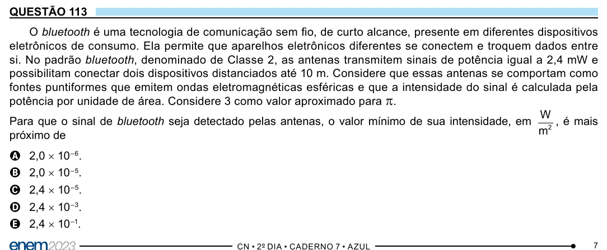

Texto extraído (pode conter ruído)

QUESTÃO 113  
O bluetooth é uma tecnologia de comunicação sem fio, de curto alcance, presente em diferentes dispositivos  
eletrônicos de consumo. Ela permite que aparelhos eletrônicos diferentes se conectem e troquem dados entre  
si. No padrão bluetooth, denominado de Classe 2, as antenas transmitem sinais de potência igual a 2,4 mW e  
possibilitam conectar dois dispositivos distanciados até 10 m. Considere que essas antenas se comportam como  
fontes puntiformes que emitem ondas eletromagnéticas esféricas e que a intensidade do sinal é calculada pela  
potência por unidade de área. Considere 3 como valor aproximado para π .  
W  
Para que o sinal de bluetooth seja detectado pelas antenas, o valor mínimo de sua intensidade, em 2 , é mais  
m  
próximo de  
A 2,0 × 10 –6 .  
B 2,0 × 10 –5 .  
C 2,4 × 10 –5 .  
D 2,4 × 10 –3 .  
E 2,4 × 10 –1 .  
7

