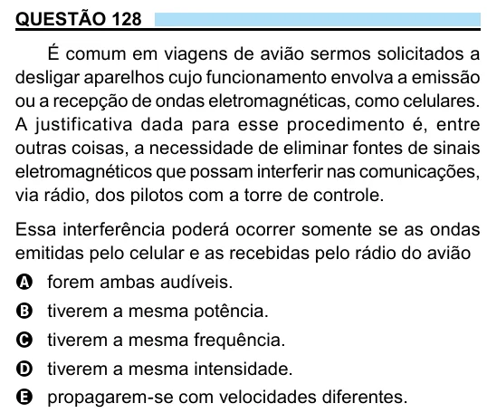

Texto extraído (pode conter ruído)

QUESTÃO 128  
É comum em viagens de avião sermos solicitados a  
desligar aparelhos cujo funcionamento envolva a emissão  
ou a recepção de ondas eletromagnéticas, como celulares.  
A justificativa dada para esse procedimento é, entre  
outras coisas, a necessidade de eliminar fontes de sinais  
eletromagnéticos que possam interferir nas comunicações,  
via rádio, dos pilotos com a torre de controle.  
Essa interferência poderá ocorrer somente se as ondas  
emitidas pelo celular e as recebidas pelo rádio do avião  
A forem ambas audíveis.  
B tiverem a mesma potência.  
C tiverem a mesma frequência.  
D tiverem a mesma intensidade.  
E propagarem-se com velocidades diferentes.

