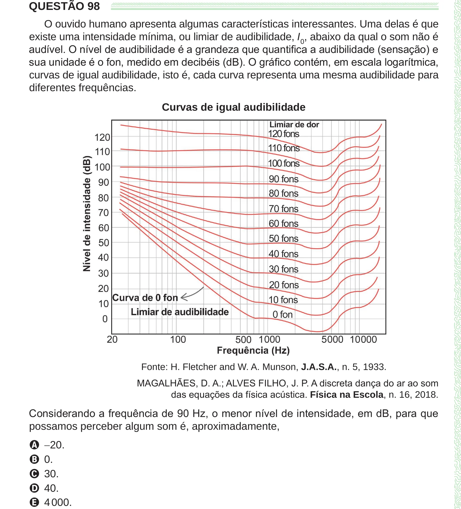

Texto extraído (pode conter ruído)

QUESTÃO 98  
O ouvido humano apresenta algumas características interessantes. Uma delas é que  
existe uma intensidade mínima, ou limiar de audibilidade, I 0 , abaixo da qual o som não é  
audível. O nível de audibilidade é a grandeza que quantifica a audibilidade (sensação) e  
sua unidade é o fon, medido em decibéis (dB). O gráfico contém, em escala logarítmica,  
curvas de igual audibilidade, isto é, cada curva representa uma mesma audibilidade para  
diferentes frequências.  
Curvas de igual audibilidade  
Fonte: H. Fletcher and W. A. Munson, J.A.S.A., n. 5, 1933.  
MAGALHÃES, D. A.; ALVES FILHO, J. P. A discreta dança do ar ao som  
das equações da física acústica. Física na Escola, n. 16, 2018.  
Considerando a frequência de 90 Hz, o menor nível de intensidade, em dB, para que  
possamos perceber algum som é, aproximadamente,  
A −20.  
B 0.  
C 30.  
D 40.  
E 4 000.

