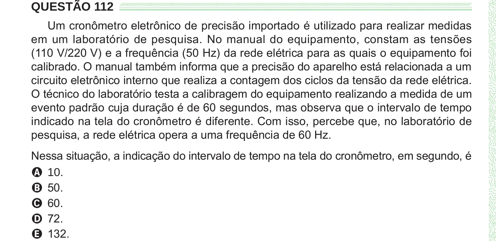

Texto extraído (pode conter ruído)

QUESTÃO 112  
Um cronômetro eletrônico de precisão importado é utilizado para realizar medidas  
em um laboratório de pesquisa. No manual do equipamento, constam as tensões  
(110 V/220 V) e a frequência (50 Hz) da rede elétrica para as quais o equipamento foi  
calibrado. O manual também informa que a precisão do aparelho está relacionada a um  
circuito eletrônico interno que realiza a contagem dos ciclos da tensão da rede elétrica.  
O técnico do laboratório testa a calibragem do equipamento realizando a medida de um  
evento padrão cuja duração é de 60 segundos, mas observa que o intervalo de tempo  
indicado na tela do cronômetro é diferente. Com isso, percebe que, no laboratório de  
pesquisa, a rede elétrica opera a uma frequência de 60 Hz.  
Nessa situação, a indicação do intervalo de tempo na tela do cronômetro, em segundo, é  
A 10.  
B 50.  
C 60.  
D 72.  
E 132.

