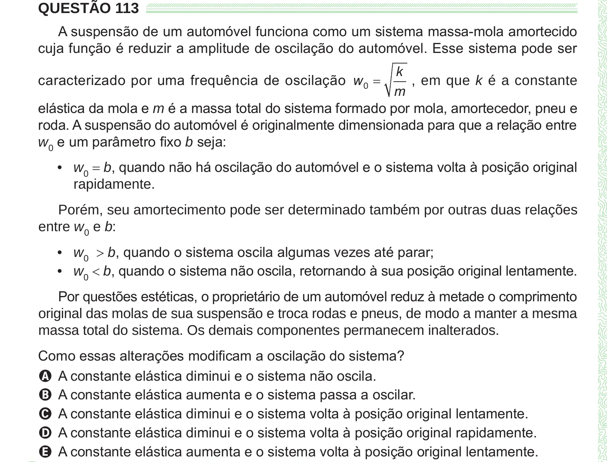

Texto extraído (pode conter ruído)

QUESTÃO 113  
A suspensão de um automóvel funciona como um sistema massa-mola amortecido  
cuja função é reduzir a amplitude de oscilação do automóvel. Esse sistema pode ser  
k  
caracterizado por uma frequência de oscilação w 0 =  
, em que k é a constante  
m  
elástica da mola e m é a massa total do sistema formado por mola, amortecedor, pneu e  
roda. A suspensão do automóvel é originalmente dimensionada para que a relação entre  
w 0 e um parâmetro fixo b seja:  
• w 0 = b, quando não há oscilação do automóvel e o sistema volta à posição original  
rapidamente.  
Porém, seu amortecimento pode ser determinado também por outras duas relações  
entre w 0 e b:  
• w 0 > b, quando o sistema oscila algumas vezes até parar;  
• w 0 < b, quando o sistema não oscila, retornando à sua posição original lentamente.  
Por questões estéticas, o proprietário de um automóvel reduz à metade o comprimento  
original das molas de sua suspensão e troca rodas e pneus, de modo a manter a mesma  
massa total do sistema. Os demais componentes permanecem inalterados.  
Como essas alterações modificam a oscilação do sistema?  
A A constante elástica diminui e o sistema não oscila.  
B A constante elástica aumenta e o sistema passa a oscilar.  
C A constante elástica diminui e o sistema volta à posição original lentamente.  
D A constante elástica diminui e o sistema volta à posição original rapidamente.  
E A constante elástica aumenta e o sistema volta à posição original lentamente.

