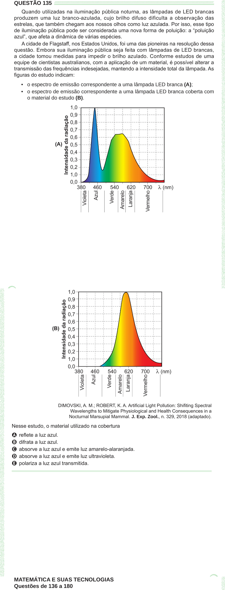

Texto extraído (pode conter ruído)

QUESTÃO 135  
Quando utilizadas na iluminação pública noturna, as lâmpadas de LED brancas  
produzem uma luz branco-azulada, cujo brilho difuso dificulta a observação das  
estrelas, que também chegam aos nossos olhos como luz azulada. Por isso, esse tipo  
de iluminação pública pode ser considerada uma nova forma de poluição: a “poluição  
azul”, que afeta a dinâmica de várias espécies.  
A cidade de Flagstaff, nos Estados Unidos, foi uma das pioneiras na resolução dessa  
questão. Embora sua iluminação pública seja feita com lâmpadas de LED brancas,  
a cidade tomou medidas para impedir o brilho azulado. Conforme estudos de uma  
equipe de cientistas australianos, com a aplicação de um material, é possível alterar a  
transmissão das frequências indesejadas, mantendo a intensidade total da lâmpada. As  
figuras do estudo indicam:  
• o espectro de emissão correspondente a uma lâmpada LED branca (A);  
• o espectro de emissão correspondente a uma lâmpada LED branca coberta com  
o material do estudo (B).  
    
DIMOVSKI, A. M.; ROBERT, K. A. Artificial Light Pollution: Shifiting Spectral  
Wavelengths to Mitigate Physiological and Health Consequences in a  
Nocturnal Marsupial Mammal. J. Exp. Zool., n. 329, 2018 (adaptado).  
Nesse estudo, o material utilizado na cobertura  
A reflete a luz azul.  
B difrata a luz azul.  
C absorve a luz azul e emite luz amarelo-alaranjada.  
D absorve a luz azul e emite luz ultravioleta.  
E polariza a luz azul transmitida.  
MATEMÁTICA E SUAS TECNOLOGIAS  
Questões de 136 a 180

