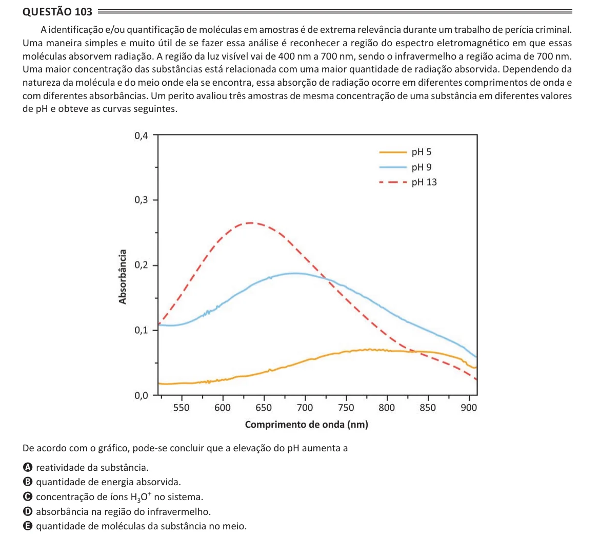

Texto extraído (pode conter ruído)

Questão 103  
A identificação e/ou quantificação de moléculas em amostras é de extrema relevância durante um trabalho de perícia criminal.  
Uma maneira simples e muito útil de se fazer essa análise é reconhecer a região do espectro eletromagnético em que essas  
moléculas absorvem radiação. A região da luz visível vai de 400 nm a 700 nm, sendo o infravermelho a região acima de 700 nm.  
Uma maior concentração das substâncias está relacionada com uma maior quantidade de radiação absorvida. Dependendo da  
natureza da molécula e do meio onde ela se encontra, essa absorção de radiação ocorre em diferentes comprimentos de onda e  
com diferentes absorbâncias. Um perito avaliou três amostras de mesma concentração de uma substância em diferentes valores  
de pH e obteve as curvas seguintes.  
De acordo com o gráfico, pode-se concluir que a elevação do pH aumenta a  
A reatividade da substância.  
B quantidade de energia absorvida.  
C concentração de íons H 3 O + no sistema.  
D absorbância na região do infravermelho.  
E quantidade de moléculas da substância no meio.

